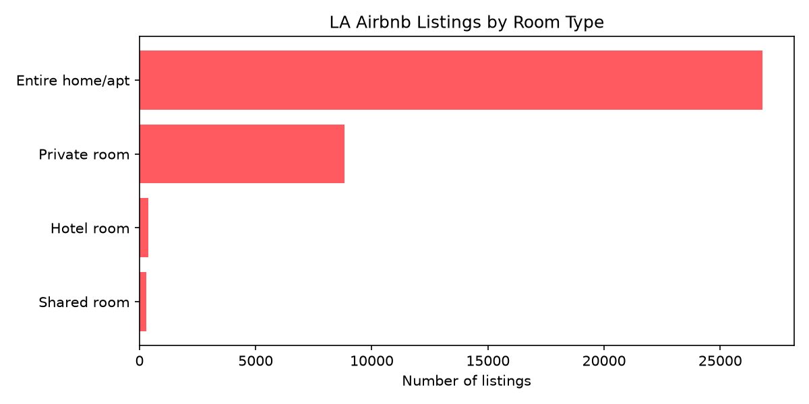
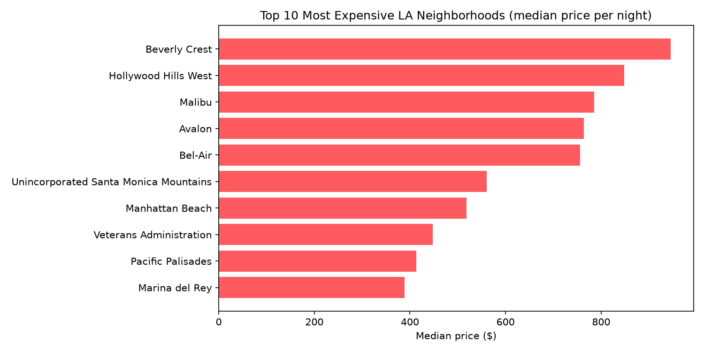
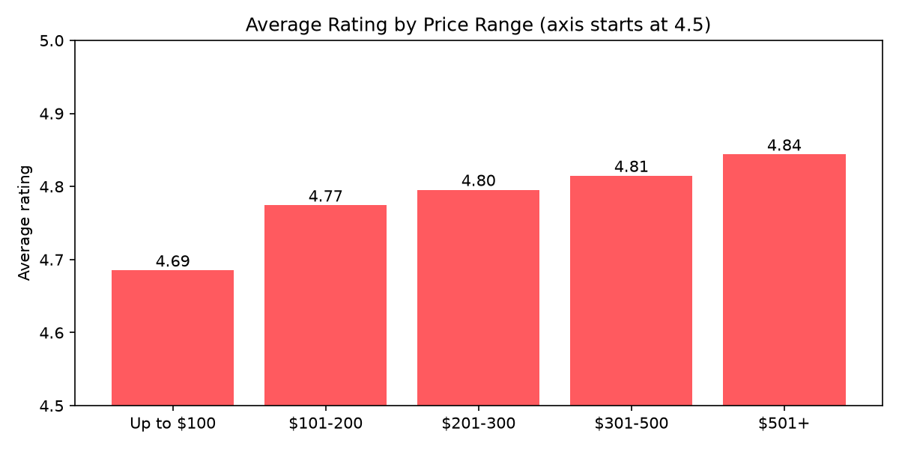
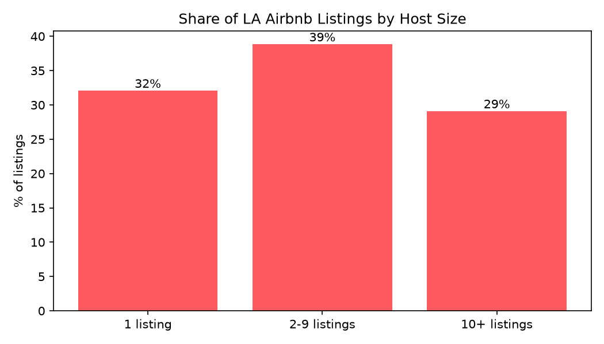

# 🏠 LA Airbnb Analysis

An analysis of **36,320 real Airbnb listings in Los Angeles** using Python (pandas and matplotlib).

**Data:** [Inside Airbnb](https://insideairbnb.com), Los Angeles listings, scraped 14 September 2026 (CC BY 4.0).

## 🧹 Data cleaning

The raw data had 43,781 listings and 90 columns. I:
- kept the 17 columns needed for the analysis
- converted prices from text ("$1,250.00") to numbers
- removed **7,094 listings with no price** (about 1 in 6)
- removed **367 extreme listings** above $2,588/night (the top 1%)

## 📊 Key findings

**1. LA Airbnb is mostly entire homes.**
74% of listings are entire homes or apartments (median $263/night). Private rooms are much cheaper (median $87).

**2. The priciest neighborhoods are hillside and beach areas.**
Beverly Crest has the highest median price ($946/night), followed by Hollywood Hills West ($848) and Malibu ($785).

**3. Pricier places get slightly better ratings.**
Average ratings rise steadily from 4.69 (up to $100) to 4.84 ($501+), but the gap is small because most listings are rated 4.7 or higher.

**4. Most listings are run by hosts with multiple properties.**
Only 32% of listings come from hosts with a single listing. 29% come from hosts with 10 or more listings.

**5. Superhosts earn better ratings and charge more.**
Superhosts average 4.87 stars vs 4.69 for other hosts, with a higher median price ($241 vs $192).

## 📁 Files

- `clean_data.py`: cleans the raw data and saves `listings_clean.csv`
- `analysis.py`: answers the 5 questions (output in `results.txt`)
- `charts.py`: creates the 4 charts

## ▶️ How to run

1. Download `listings.csv` for Los Angeles from [insideairbnb.com/get-the-data](https://insideairbnb.com/get-the-data)
2. Run `python3 clean_data.py`, then `python3 analysis.py`, then `python3 charts.py`